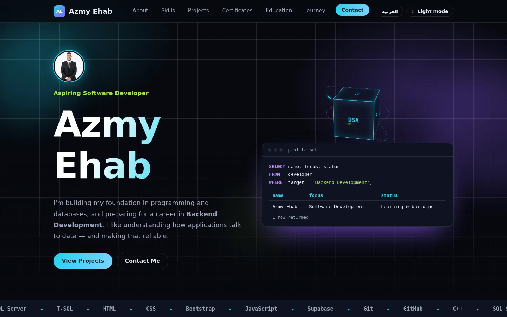
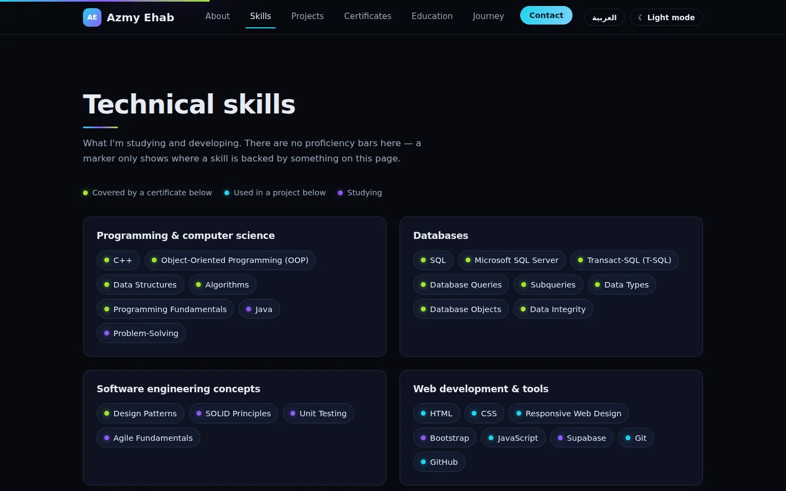
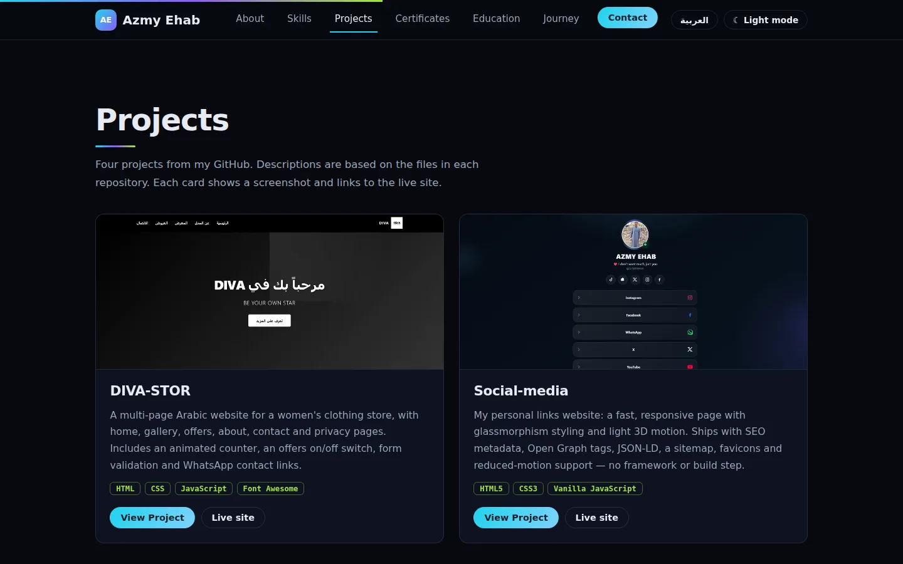
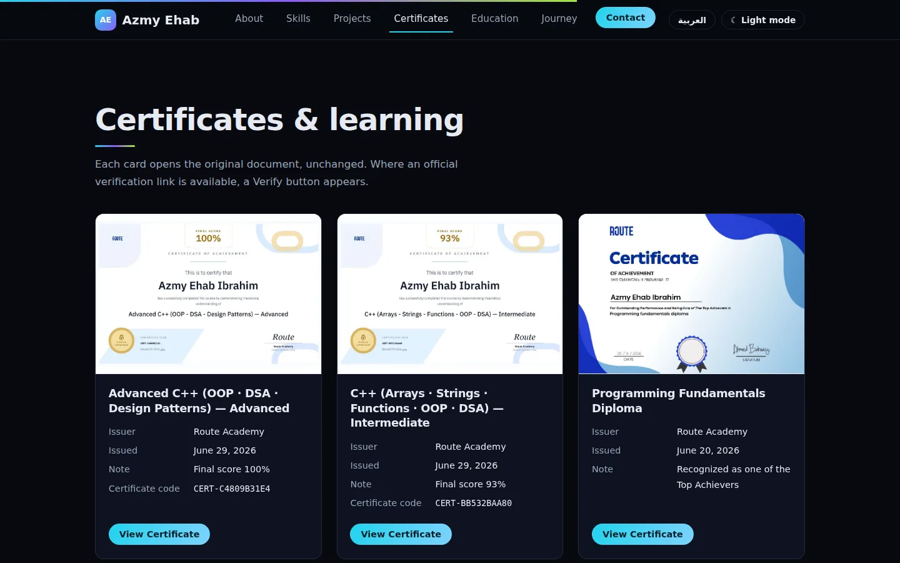
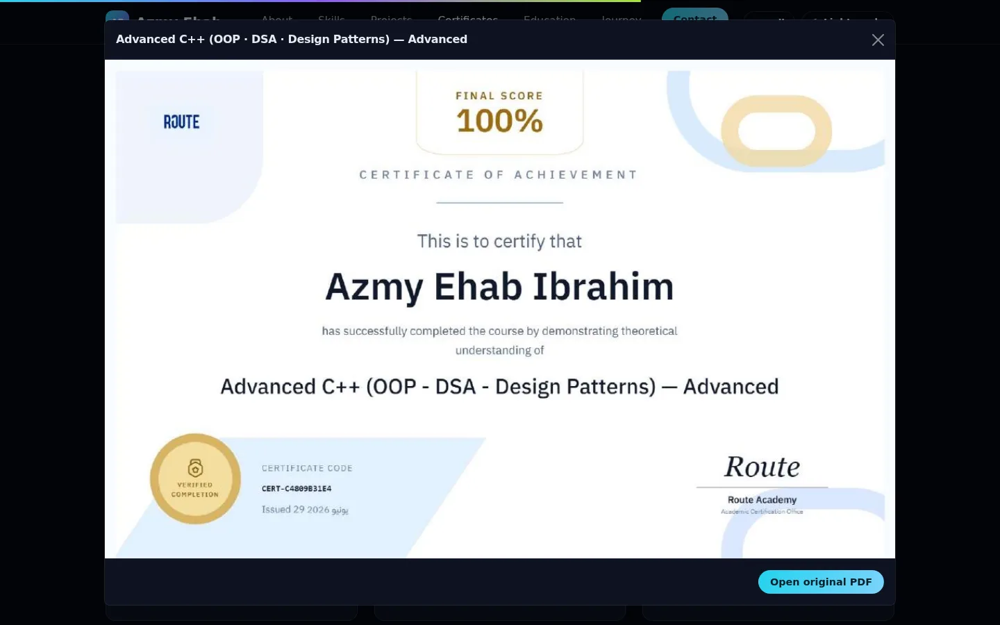
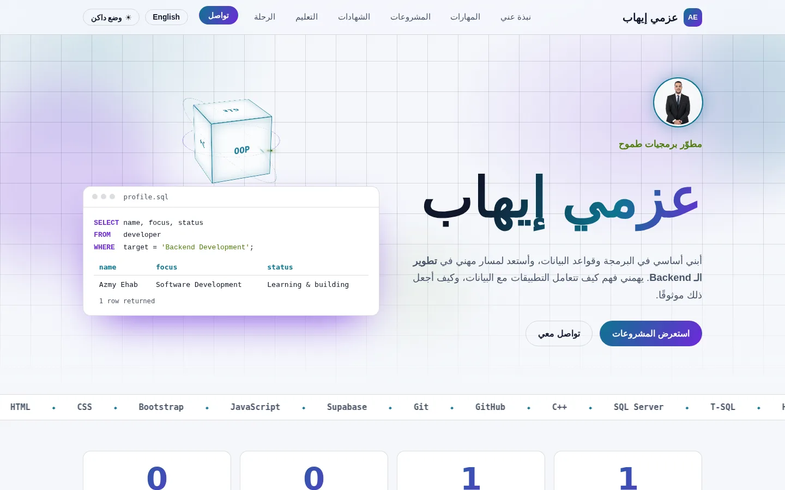
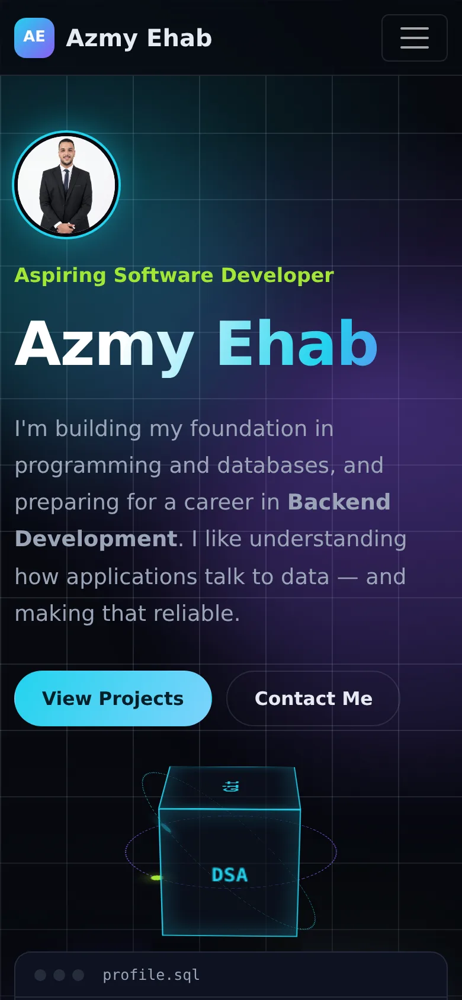

<div align="center">

# Azmy Ehab — Professional Portfolio

**A bilingual (English / Arabic), dark / light, 3D-animated portfolio built with only HTML5, CSS3 and Bootstrap 5.**


-22d3ee)




</div>

---

## 1. Project at a glance

This portfolio presents my professional identity as an aspiring Software Developer focused on **SQL, database fundamentals and Backend Development**: my skills, four real GitHub projects, five verified-by-document certificates, education and learning journey.

The assignment constraint I set for myself: **no application JavaScript at all.** Language switching, theme switching, 3D motion, count-up numbers, the scroll progress bar and every animation are pure CSS. The only script on the page is Bootstrap's own bundle, used for the responsive navbar, the certificate pop-ups and scroll-spy.

| | |
|---|---|
| **Author** | Azmy Ehab (عزمي إيهاب) |
| **Stack** | HTML5 · CSS3 · Bootstrap 5.3.3 (local copy) |
| **Languages** | English (LTR) and Arabic (RTL), switchable live |
| **Themes** | Dark (default) and Light, switchable live |
| **Page weight** | ~139 KB of own code and images (HTML 48 KB, CSS 22 KB) + Bootstrap |
| **Content policy** | Everything shown is real and backed by a document or repository |

---

## 2. Design concept

The visual idea comes from my direction — **databases and backend**. The hero is a live **SQL console** that types a query describing me (`SELECT name, focus, status FROM developer WHERE target = 'Backend Development'`) and returns a result row. Around it, a **3D cube** labelled with technologies I actually studied rotates inside two orbiting rings.

- **Palette:** deep navy-black surfaces with **cyan**, **purple** and **lime** accents, defined as CSS custom properties so the whole site re-themes by changing a handful of tokens.
- **Typography:** *Bricolage Grotesque* (display/body), *IBM Plex Sans Arabic* (Arabic), *JetBrains Mono* (code). Every font has a system fallback.
- **Honest data visualisation:** no fake progress bars. A skill gets a coloured marker only when something on the page backs it — a certificate (lime), a project (cyan) — otherwise it is marked as *studying* (purple).

| Skills & evidence markers | Projects with real screenshots |
|---|---|
|  |  |

| Certificates (original PDFs) | Certificate viewer (Bootstrap modal) |
|---|---|
|  |  |

---

## 3. Animations and 3D (all CSS)

| Feature | How it is built |
|---|---|
| **Typing SQL console** | Three lines revealed in sequence with `clip-path` + `steps()` keyframes; the result table fades in afterwards |
| **3D rotating cube + orbit rings** | `transform-style: preserve-3d`, six `translateZ` faces, `backface-visibility: hidden`, two rings rotating on different axes |
| **Count-up statistics** | `@property --n` (typed integer custom property) animated with a scroll-driven timeline, rendered through `counter()` |
| **Scroll progress bar** | `animation-timeline: scroll(root)` scales a gradient bar across the top |
| **Scroll reveal** | `animation-timeline: view()` with `animation-range` — no observers, no scripts |
| **Animated heading underlines** | Same `view()` timeline, `scaleX` draw-in |
| **3D tilt on hover** | `perspective()` + `rotateX/Y` on project, certificate, skill, stat and link cards, and the portrait |
| **Floating glow orbs, tech marquee** | Keyframe drift and an infinitely sliding track (pauses on hover) |
| **Pulsing "Now" step** | Keyframed `box-shadow` on the learning-journey timeline |

**Accessibility of motion:** a `prefers-reduced-motion` block disables every animation and transition, and the content stays fully visible without them. Where scroll-driven animation is unsupported, elements simply render in their final state.

---

## 4. Bilingual + theming with zero JavaScript

Two visually hidden checkboxes sit at the top of `<body>`:

```html
<input class="switch-input" type="checkbox" id="langToggle">   <!-- checked = Arabic -->
<input class="switch-input" type="checkbox" id="themeToggle">  <!-- checked = light  -->
```

Styled `<label for="…">` buttons in the navbar toggle them, and CSS reacts with the `:has()` selector:

```css
body:has(#langToggle:checked)  { direction: rtl; font-family: var(--font-ar); }
body:has(#langToggle:checked) .en { display: none; }
:root:has(#themeToggle:checked) { --bg: #f5f7fb; --text: #0f172a; /* …light tokens… */ }
```

Every piece of text exists twice — `<span class="en">` and `<span class="ar" lang="ar">` — so screen readers announce the correct language. Layout uses **CSS logical properties** (`inset-inline-start`, `margin-inline-start`, …), so the Arabic version mirrors correctly without a separate stylesheet. Both switches are real form controls, so they are **keyboard accessible** (Tab + Space) with a visible focus ring.

| Arabic, light theme | Mobile (390 px) |
|---|---|
|  |  |

---

## 5. Clean, SEO-friendly code

- **Semantic HTML5:** `header`, `nav`, `main`, `section` (each with `aria-labelledby`), `article`, `figure`, `dl`, `ol`, `footer`; **one `<h1>`**, logical `h2 → h3` outline.
- **Metadata:** descriptive `<title>` and meta description, `author`, `robots`, `color-scheme`, `theme-color`, Open Graph and Twitter card tags, `og:locale` with an Arabic alternate.
- **Structured data:** a `schema.org/Person` JSON-LD block (name in both languages, job title, skills, `sameAs` profile links). It is plain data, not executable code.
- **Images:** every image has meaningful `alt` text, explicit `width`/`height` (no layout shift), `loading="lazy"` below the fold, `fetchpriority="high"` for the hero avatar, WebP for photos and screenshots.
- **Links:** external links use `rel="noopener noreferrer"`; a *skip to content* link is the first focusable element.
- **Performance:** no frameworks beyond Bootstrap, no build step, no external images, local Bootstrap copy, only Google Fonts as an external request.
- **Maintainability:** one stylesheet organised by section with design tokens at the top; consistent BEM-style class names (`project__media`, `cert__thumb`, `step--now`); no inline styles except the numeric values of the count-up tiles.
- **Verified:** no duplicate IDs, no broken in-page anchors, no images without `alt`, no console errors in desktop and mobile runs.

---

## 6. Authenticity of content

The portfolio follows a strict rule: **nothing invented.**

- Certificates are the original PDFs, shown unchanged, with only the details printed on them (issuer, date, code, score).
- Each certificate has a *Verify Certificate* slot that stays hidden until the official verification link is added — no link is guessed from a code or QR image.
- Project descriptions were written after reading each repository; limitations are stated (for example, the login in *krast-alnqwt* is client-side only).
- No testimonials, fake statistics or proficiency percentages. The four counters (5 certificates, 4 projects, 2 C++ courses, 1 diploma) are literal counts of what is on the page.

### Projects

| Project | What it is | Links |
|---|---|---|
| **DIVA-STOR** | Multi-page Arabic website for a clothing store | [Repo](https://github.com/AZMYEHAB21/DIVA-STOR) · [Live](https://azmyehab21.github.io/DIVA-STOR/) |
| **Social-media** | Personal links page with glassmorphism and light 3D motion | [Repo](https://github.com/AZMYEHAB21/Social-media) · [Live](https://azmyehab21.github.io/Social-media/) |
| **krast-alnqwt** | Arabic RTL gift-money records manager (localStorage, CSV export) | [Repo](https://github.com/AZMYEHAB21/krast-alnqwt) · [Live](https://azmyehab21.github.io/krast-alnqwt/) |
| **Athar** | Arabic RTL Qur'an / azkar site, installable PWA | [Repo](https://github.com/AZMYEHAB21/-) · [Live](https://azmyehab21.github.io/-/) |

---

## 7. Project structure

```
portfolio/
├── index.html                  # all content, bilingual, semantic markup
├── css/style.css               # design tokens, layout, themes, 3D + animations
├── assets/
│   ├── vendor/                 # Bootstrap 5.3.3 CSS + JS bundle (local copy)
│   ├── certificates/           # original PDFs + JPG previews
│   ├── projects/               # project screenshots (WebP)
│   └── images/                 # portrait (WebP)
├── docs/screenshots/           # images used in this README
├── robots.txt
└── README.md
```

---

## 8. Run, edit and deploy

**Run locally:** open `index.html`, or `python3 -m http.server 8000` and visit `http://localhost:8000`.

**Edit content:** change the matching `.en` and `.ar` spans in `index.html`. Colours and fonts live in the `:root` block at the top of `css/style.css`.

**Add a certificate verification link:** in the certificate card, remove the comment markers around the Verify button and paste the official URL in `href`.

**Deploy on GitHub Pages**
1. Create a repository and upload the contents of this folder (`index.html` at the root).
2. *Settings → Pages → Deploy from a branch → `main` / `(root)` → Save.*
3. The site is live at `https://azmyehab21.github.io/<repository>/` after about a minute.
4. Optional SEO step after publishing: add a `sitemap.xml` and a `Sitemap:` line to `robots.txt` using the real published URL.

**Browser support:** current Chrome, Edge, Safari and Firefox. Features that need newer engines (`:has()`, scroll-driven animation, `@property`) degrade gracefully to a static, fully readable page.

**Known limitation:** because there is no JavaScript, the language/theme choice is not remembered after a reload (defaults: English, dark).

---

## 9. Credits

Bootstrap 5 (MIT) · Google Fonts: Bricolage Grotesque, IBM Plex Sans Arabic, JetBrains Mono (SIL OFL). Certificates belong to their issuers (Route Academy, Edraak); their logos appear only inside the unmodified original documents.

---

## 10. نبذة بالعربية

موقع Portfolio احترافي بلغتين (إنجليزي/عربي مع دعم كامل لاتجاه RTL) ووضعين (داكن/فاتح)، مبني بـ **HTML وCSS وBootstrap فقط** دون أي JavaScript خاص بي. يضم مكعبًا ثلاثي الأبعاد وحلقات دوّارة وعدّادات متحركة وشريط تقدّم للتمرير وتأثيرات إمالة ثلاثية الأبعاد، وكلها بـ CSS. كل المحتوى حقيقي: شهادات أصلية، أربعة مشروعات فعلية بلقطات شاشة وروابط مباشرة، وبدون نسب إتقان مصطنعة.

<div align="center">

© 2026 Azmy Ehab. All rights reserved.

</div>
